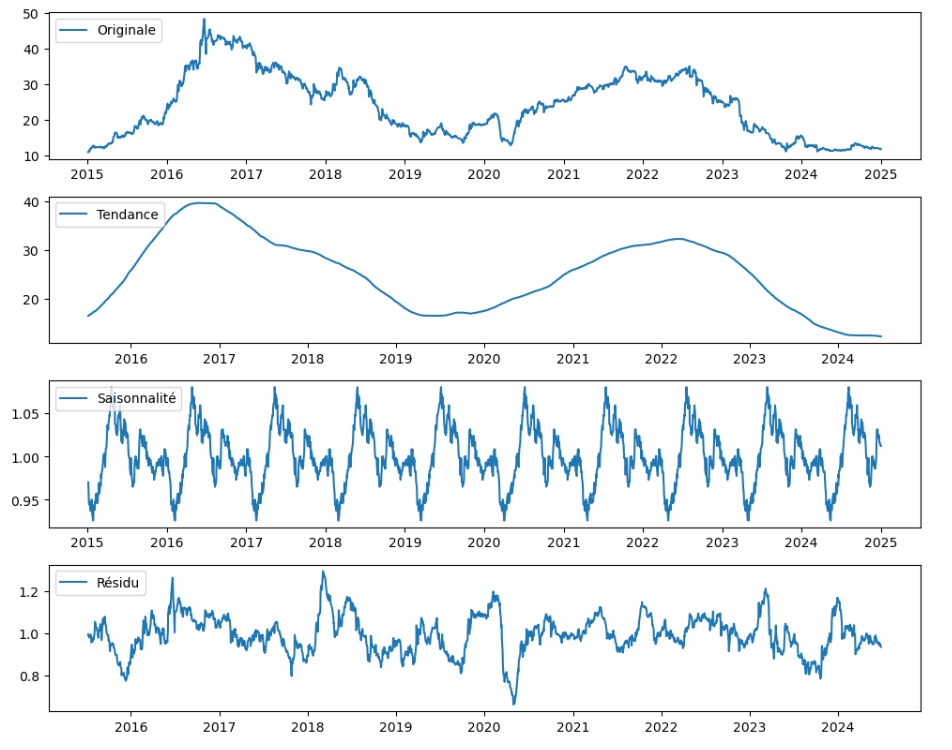
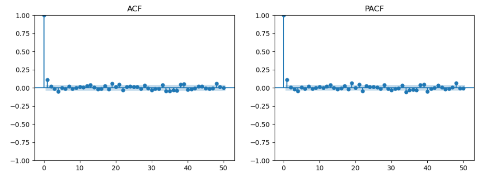
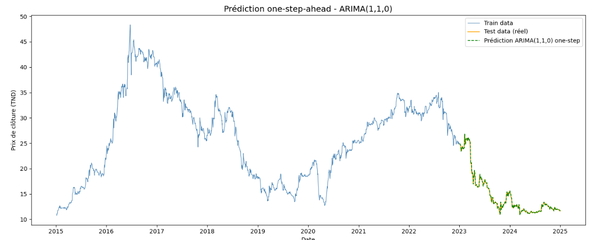
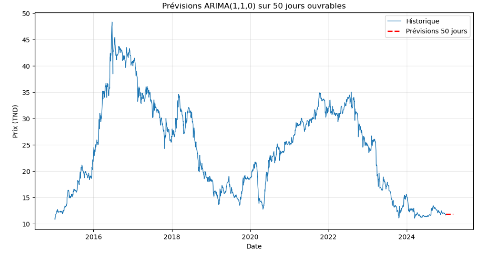

# Time Series Analysis and Forecasting: Euro-Cycles (ECYCL)


**Objective:** analyze and forecast the daily closing price of **Euro-Cycles (ECYCL)**, a company listed on the
Tunis Stock Exchange, with classical time-series models.

The project covers the full workflow: collecting the data by web scraping, testing stationarity, identifying the
model with ACF / PACF and `auto_arima`, comparing ARIMA and seasonal SARIMA with walk-forward validation, and
forecasting the next 50 trading days.

## Data
- **Source:** daily price history scraped from [ilboursa.com](https://www.ilboursa.com/marches/historiques/ECYCL)
  with Selenium (the scraping code is in the notebook).
- **File:** [`data/eurocycles_stock_prices.csv`](data/eurocycles_stock_prices.csv), June 2013 to April 2026:
  date, open, high, low, close, volume, traded value and daily change (French number format, for example `11,50`).
- **Period modeled:** January 2015 to December 2024, **2,440 trading days**. Over this period the price rose from
  10.87 TND to a peak of 48.35 TND (June 2016), then ended at 11.72 TND.

## Method
1. **Data preparation:** parse dates, sort chronologically, convert French-formatted numbers, check missing values.
2. **Exploration:** price evolution and multiplicative decomposition (trend, yearly seasonality, residuals).
3. **Stationarity:** Augmented Dickey-Fuller test on the price (p = 0.56, not stationary), on its logarithm
   (p = 0.55) and on the first difference (p < 0.001, stationary), so **d = 1**.
4. **Model identification:** ACF and PACF of the differenced series (significant spike at lag 1 in the PACF) and
   `auto_arima` both point to **ARIMA(1,1,0)**. A seasonal **SARIMA(1,1,0)(5,1,0)[5]** (weekly cycle of 5 trading
   days) is tested as an alternative.
5. **Validation:** chronological 80 / 20 split (1,952 training days, 488 test days, January 2023 to December 2024)
   with **walk-forward one-step-ahead forecasts**: each day, the model is updated with the actual price and predicts
   the next one.
6. **Forecast:** ARIMA(1,1,0) refitted on the full history to forecast the next 50 trading days.

## Results

| Model | RMSE | MAE | MAPE |
|---|---|---|---|
| **ARIMA(1,1,0)** | **0.2849** | **0.1690** | **1.11%** |
| SARIMA(1,1,0)(5,1,0)[5] | 0.3077 | 0.1967 | 1.30% |

- **ARIMA(1,1,0) is the best model** on all three metrics: its next-day forecasts are off by 1.11% on average.
- The seasonal component does not improve the forecasts, so the extra complexity of SARIMA is not justified.
- The **50-day forecast is almost flat** around 11.7 TND: the model sees no clear trend after the long decline of 2023-2024.



| ACF and PACF of the differenced series | Walk-forward forecasts on the test period |
|---|---|
|  |  |



## Project structure
```
Time-Series-Analysis-and-Forecasting-for-a-Company/
├── data/
│   └── eurocycles_stock_prices.csv
├── notebooks/
│   └── eurocycles_time_series_forecasting.ipynb   scraping, analysis, models, forecast (comments in French)
├── images/                                        charts used in this README
├── requirements.txt
└── LICENSE
```

## How to run
```bash
git clone https://github.com/hamzacharrad29-png/Time-Series-Analysis-and-Forecasting-for-a-Company.git
cd Time-Series-Analysis-and-Forecasting-for-a-Company
python -m venv .venv
source .venv/bin/activate          # Windows: .venv\Scripts\activate
pip install -r requirements.txt
jupyter notebook notebooks/eurocycles_time_series_forecasting.ipynb
```
The data is already in `data/`. Skip the scraping cell unless you want to refresh it (it needs Google Chrome and
takes several minutes).

## Limitations and next steps
- **Benchmark against a naive forecast.** Predicting that tomorrow's price equals today's gives RMSE 0.2927,
  MAE 0.1700 and MAPE 1.11% on the same test period. ARIMA(1,1,0) is only slightly better (RMSE 0.2849), which is
  typical for stock prices: daily moves are close to a random walk. The value of the model lies more in the
  statistical analysis than in beating the market.
- Next-day forecasts are much easier than long horizons; the 50-day forecast carries wide uncertainty and should be
  shown with confidence intervals.
- Next: model returns and volatility (GARCH), add external variables (market index, volume), and compare with
  machine-learning models.

## Tools
Python, pandas, NumPy, Matplotlib, Seaborn, statsmodels (ADF test, ACF / PACF, seasonal decomposition, ARIMA,
SARIMAX), pmdarima (`auto_arima`), scikit-learn (metrics), Selenium (web scraping), Jupyter Notebook.

## Author
**Hamza Charrad**, Data Analyst
[LinkedIn](https://www.linkedin.com/in/hamza-charrad/) · [Portfolio](https://hamzacharrad29-png.github.io/Portfolio/)
